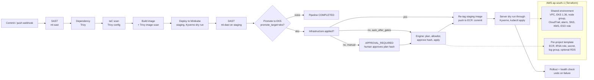
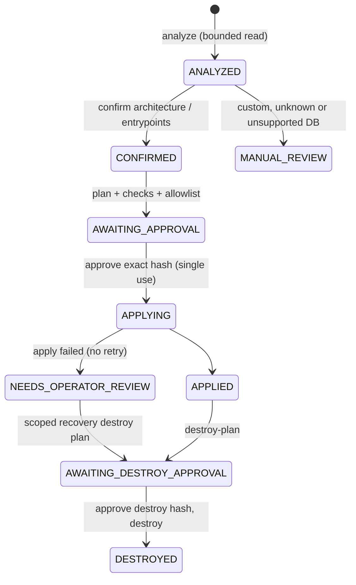

# EKS deployment (Modules 8-11)

This is the final record of the EKS work: how CloudSentinel provisions per-project infrastructure on AWS and promotes
a scanned image to EKS (Module 8), how secrets reach the pods (Module 9), how the cluster enforces Kubernetes security
(Module 10) and how it is monitored (Module 11). It brings together the run log (`docs/eks-progress.md`), the cost
gate (`docs/eks-cost-gate.md`), the promote stage (`docs/promote-stage.md`), the pipeline runs
(`docs/pipeline-e2e-results.md`, `docs/pipeline-fixes.md`) and the evidence under `docs/evidence/eks/`.

The live run was on 2026-11-25/26 in `ap-south-1`. The cluster existed from 2026-11-25 17:46:48 PKT to 2026-11-26
00:34:01 PKT and was then destroyed. Nothing billable is left (`docs/evidence/eks/stage7/destroy.txt`). Times are PKT
(UTC+5) unless marked UTC. The AWS account ID is written as `<account-id>`.

Contents:
1. [Architecture](#1-architecture)
2. [Generator and engine design](#2-generator-and-engine-design)
3. [Requirements: implementation and evidence](#3-requirements-implementation-and-evidence)
4. [Measured numbers](#4-measured-numbers)
5. [Reproduction](#5-reproduction)
6. [Limitations](#6-limitations)
7. [Mistakes and surprises](#7-mistakes-and-surprises)

## 1. Architecture

### Pipeline order

A push webhook starts the orchestrator (`backend/services/orchestrator.js`). Each stage runs only if the one before it
passed. Promote is the last stage and runs only for projects with `promote_target=eks`.



- **Stages up to DAST** run on the local stack and Minikube. The image scan is part of Deploy, so an image with a
  CRITICAL finding never reaches a cluster (`docs/pipeline-e2e-results.md`, "Where the image scan runs").
- **Promote** re-tags the exact image that staging built, scanned and DAST-tested as `<project ECR repo>:<commit SHA>`.
  It never rebuilds and never uses `latest` (`backend/services/promoteStage.js`, `docs/promote-stage.md`).

### Terraform provisions, manifests deploy

Terraform has two layers, and Kubernetes objects are never created by Terraform:

| Layer | Code | Creates |
|---|---|---|
| Shared environment (applied once by an admin) | `terraform/environments/aws-demo/{main,security,variables,outputs}.tf`, `aws-demo.tfvars` | VPC 10.40.0.0/16 (2 private + 2 public subnets, 1 NAT gateway, flow logs), EKS 1.36 with a managed node group (2 x m7i-flex.large, min 2 / max 3), add-ons (vpc-cni, kube-proxy, coredns, metrics-server), control-plane logs, multi-region CloudTrail, metric filter + alarm + SNS email, 2 KMS keys, OIDC provider, ESO IRSA role, permissions boundary `cloudsentinel-workload-boundary` |
| Per project (generated, applied by the engine) | `terraform/templates/eks-project/`, `terraform/modules/project-workload/`, `terraform/modules/project-database/` | per component: ECR repository (immutable tags), IRSA role with the boundary, Secrets Manager secret, CloudWatch log group; for two/three-tier: private, encrypted RDS (PostgreSQL or MySQL) with an RDS-managed master secret, subnet group and security group |

Kubernetes objects come from the generator (`backend/services/eksManifests.js`, target=eks in
`backend/services/deployment.js`): a Namespace with Pod Security `restricted`, ServiceAccount (IRSA annotation),
ConfigMap, ExternalSecret(s), Deployment (non-root, limits, pinned ECR image), Service and HPA. Platform components
are installed by pinned Helm charts: `k8s/eks/platform-install.sh` (External Secrets Operator + ClusterSecretStore,
Kyverno + the seven CEL policies) and `k8s/eks/monitoring-install.sh` (kube-prometheus-stack, Loki, Alloy). Versions
are pinned in `k8s/eks/versions.env`.

Three-tier layout: the frontend gets a `LoadBalancer` Service, the backend a `ClusterIP` Service, and the database is
private and accepts 5432 only from the node security group (`docs/evidence/eks/stage5/9103-three-tier-18-demo.txt`).

## 2. Generator and engine design

Engine: `backend/services/eksWorkloadEngine.js`. Detection, tfvars and allowlist: `backend/services/eksWorkload.js`.
API: `/api/infrastructure/:id/workload/{analyze,confirm,plan,approve,apply,destroy-plan,destroy}` in
`backend/routes/infrastructure.js` (owner only). CLI with the same engine: `scripts/infra-cli.js`. UI:
`frontend/src/components/WorkloadInfrastructure.jsx`. Reference: `backend/docs/infrastructure-planning.md`
("EKS container workloads").



| Step | What happens | Safety gate |
|---|---|---|
| Detection | Reads the checkout within limits: languages, frameworks, databases, ports, entrypoints and env-var **names** (never values). Classifies one-tier, two-tier, three-tier or static | Declarations only, never runtime. Custom/unknown architectures, MongoDB/Redis/SQLite and multi-engine repositories return `MANUAL_REVIEW`; an uncertain entrypoint returns `CONFIRM_ENTRYPOINT`; HTML-only goes to the separate static-site engine |
| Confirmation | The owner confirms the architecture and any uncertain entrypoint | Recorded with user and time in the project record |
| Templates | Copies only the fixed templates; writes values only to `terraform.tfvars.json` | Only validated values: project id, names, ports, env-var names. Protected projects 11, 13 and 17 refused |
| Validate | `terraform fmt -check`, Trivy config with `--tf-vars`, `init -lockfile=readonly`, `validate` | Any CRITICAL stops; the plan is refused if Trivy did not evaluate the workload module |
| Plan | `plan -out`, `show -json`, SHA-256 of the plan file | Plan valid for 30 minutes |
| Allowlist | `inspectPlan`: exact resource types and counts per architecture, create only, required tags, no public RDS, RDS-managed password, no CIDR ingress to the database, IRSA trust limited to the component service account, inline policy limited to its own secret and log group, boundary attached, provider pinned to the account and `ap-south-1` | Anything else rejects the plan (unit test "allowlist rejects public RDS, open database access, extra types, missing tags, wrong account and admin IAM") |
| Approval | Approve the exact plan SHA-256 | Single use, 15 minutes, same user, consumed before Terraform runs; a plan file changed after approval is rejected |
| Apply | `terraform apply` of the approved file with the refreshable `AWS_PROFILE` | `INFRA_APPLY_ENABLED=true`; kill switch off (`INFRA_KILL_SWITCH` not `on`, no `KILL_SWITCH` file); AWS identity must be the pinned account and region; a failed apply goes to `NEEDS_OPERATOR_REVIEW` and is never retried; state backed up after every apply/destroy |
| Destroy | `plan -destroy`, separate single-use approval, destroy | The destroy plan may delete only the applied addresses. Recovery from `NEEDS_OPERATOR_REVIEW` may delete only state addresses that are a subset of the approved plan (`recoveryAddresses`) |

Every step is appended to the project's `audit.jsonl` (no secrets).

### Approval modes (promote stage)

Set per project with `PUT /api/infrastructure/:projectId/promote-settings` (migration `024_promote_stage.sql`):

| `promote_approval` | When the project's infrastructure is not applied yet |
|---|---|
| `manual` (default) | The stage plans, runs the allowlist and stops at `APPROVAL_REQUIRED` with the plan summary. A human approves the hash through the engine |
| `auto_after_gates` | After SAST, dependency, IaC, image scan, staging deploy and DAST have all passed, the stage approves the exact plan hash as `pipeline gates (execution N)` and applies, but only if the allowlist accepts the plan and the apply gate is open. Otherwise `NEEDS_REVIEW` |

Promote also fails closed on its own: it checks `stages_completed` again, refuses to overwrite a tag that holds a
different image, runs a server-side dry run through Kyverno before applying, and runs `kubectl rollout undo` when the
rollout or the health check fails (`docs/promote-stage.md`, decision table).

## 3. Requirements: implementation and evidence

The FE requirements are copied word for word from the SRS: section 1.7.8 (Module 8), 1.7.9 (Module 9), 1.7.10
(Module 10) and 1.7.11 (Module 11). The screen-level FR requirements come from the SRS mockup tables in section 2.2
(M16, M17, M19 and M20). Status is **met**, **partly met** or **not met**, with the reason.

### Module 8: Secure Cloud Provisioning & Kubernetes Deployment

SRS 1.7.8. Purpose: "Deploy secure cloud infrastructure and containerized applications using Infrastructure-as-Code."

| Req | SRS text |
|---|---|
| FE-1 | Provision cloud infrastructure using Terraform |
| FE-2 | Configure secure networking environments (VPC, subnets) |
| FE-3 | Deploy applications to Kubernetes clusters |
| FE-4 | Support scalable container orchestration |
| FE-5 | Maintain reproducible infrastructure deployments |

| Req | What implements it | Implementation | Evidence | Status |
|---|---|---|---|---|
| FE-1 | Shared cloud environment (VPC, EKS, node group, logging) as code | `terraform/environments/aws-demo/`, `scripts/eks-shared-plan.sh` | `docs/evidence/eks/stage3/shared-plan-summary.txt`, `docs/evidence/eks/stage4/apply-times.txt`, `docs/evidence/eks/stage4/cluster-check.txt` | met |
| FE-1 | Per-project Terraform generated from fixed templates for one-, two- and three-tier applications | `terraform/templates/eks-project/`, `terraform/modules/project-workload/`, `terraform/modules/project-database/`, `backend/services/eksWorkload.js` (tfvars) | `docs/evidence/eks/stage1/terraform-trivy.txt` (4/4 folders pass fmt, init, validate, Trivy) | met |
| FE-1 | Architecture detection that selects the template | `backend/services/eksWorkload.js` (detect, classify) | `docs/evidence/eks/stage1/infra-cli-smoke.txt`; `docs/evidence/eks/stage5/9101-one-tier-01-analyze.json`, `9102-two-tier-01-analyze.json`, `9103-three-tier-01-analyze.json`, `9104-static-01-analyze.json` | partly met: declarations only (dependency manifests, files), not runtime; unsupported databases go to manual review |
| FE-1 | Validate and plan before apply; reject anything outside the allowlist | `backend/services/eksWorkloadEngine.js`, `backend/services/eksWorkload.js` (`inspectPlan`) | `docs/evidence/eks/stage1/unit-tests.txt` (tests 12-14, 17); `docs/evidence/eks/stage5/9101-one-tier-03-plan.json`; `docs/evidence/eks/stage5/9104-static-plan-allowlist.txt` (negative test REJECTED) | met |
| FE-1 | Human approval of the exact plan, single use; apply gate and kill switch | `backend/services/eksWorkloadEngine.js` (`applyGate`, approval TTL), `backend/routes/infrastructure.js` | `docs/evidence/eks/stage5/gate-off.json`, `gate-on.json`, `9101-one-tier-04-approve.json`, `9101-one-tier-05-apply.json` (approval `consumedAt`); `docs/evidence/eks/stage1/unit-tests.txt` (tests 15, 16, 18) | met |
| FE-1 | Apply per-project infrastructure on AWS | same | `docs/evidence/eks/stage5/9101-one-tier-05-apply.json`, `9102-two-tier-16-apply.json`, `9103-three-tier-16-apply.json` | partly met: the static site was planned and allowlist-checked but not applied (old provider pin, see Limitations) |
| FE-2 | VPC 10.40.0.0/16 with 2 private and 2 public subnets, one NAT gateway, flow logs; nodes in private subnets without public IPs; private RDS that accepts 5432 only from the node security group; API endpoint limited to one /32 plus private access | `terraform/environments/aws-demo/main.tf`, `terraform/modules/project-database/main.tf`, `backend/services/eksWorkload.js` (allowlist: no public RDS, no CIDR ingress to the database) | `docs/evidence/eks/stage3/shared-plan-summary.txt`, `docs/evidence/eks/stage4/cluster-check.txt` (`publicCidrs: 1`), `docs/evidence/eks/stage5/9103-three-tier-18-demo.txt` (backend and database unreachable from outside) | met for VPC and subnets. Inside the cluster there is no NetworkPolicy |
| FE-3 | Build a hardened image and deploy it with generated manifests | `backend/services/eksManifests.js`, `backend/services/deployment.js` (target=eks) | `docs/evidence/eks/stage5/9101-one-tier-07-deploy.txt`, `9102-two-tier-17-deploy.txt`, `9103-three-tier-17-deploy.txt` | met |
| FE-3 | Promote the scanned staging image to EKS after all gates (manual or `auto_after_gates`); the Promote node masks AWS identifiers | `backend/services/promoteStage.js`, `backend/services/orchestrator.js`, `backend/migrations/024_promote_stage.sql`, `backend/routes/infrastructure.js` (promote-settings), `frontend/src/pages/CICDPipeline.jsx`, `frontend/src/utils/pipelineStages.js`, `scripts/promote-verify.js` | `docs/evidence/eks/promote/01-minikube-integration.txt`, `docs/evidence/eks/promote/02-live-9101-target-unavailable.txt`, `docs/evidence/pipeline/run4-python-clean-promote-execution-113.json` | partly met: on EKS only the "target unavailable" outcome was shown live; push, rollout and rollback were shown on Minikube; the first-time `auto_after_gates` apply is tested by unit tests only; migration 024 is not applied to the shared database |
| FE-3 | Publicly reachable application endpoint | generated `LoadBalancer` Service (NLB annotation) | `docs/evidence/eks/stage5/stop-load-balancer.txt`, `9101-one-tier-09-nlb-surprise.txt`; demos by port-forward: `9102-two-tier-18-demo.txt`, `9103-three-tier-18-demo.txt` | partly met: the Free plan refuses load balancers. One NLB was created for 9101 by controller retries; the others stayed Pending |
| FE-4 | Pod and node scaling | HPA in the generated manifests; node group min 2 / max 3 in `terraform/environments/aws-demo/main.tf` | `docs/evidence/eks/stage6/07-hpa-load-test.txt` (2 -> 4 pods); `docs/evidence/eks/minikube/07-hpa-scaling.txt` | partly met: pod autoscaling shown; node autoscaling is configured as limits only (no autoscaler installed) and was not demonstrated |
| FE-5 | Pinned versions and lock files (Terraform, AWS provider, registry modules, add-ons, Helm charts), fixed templates, saved plans with SHA-256, state backups | `terraform/templates/eks-project/.terraform.lock.hcl`, `terraform/environments/aws-demo/.terraform.lock.hcl`, `k8s/eks/versions.env`, `backend/services/eksWorkloadEngine.js` | `docs/evidence/eks/stage4/cluster-check.txt` (add-ons on the pinned builds), `docs/evidence/eks/stage6/13-capacity-and-access.txt` (chart versions) | met |
| FE-5 | Destroy everything that was created, with a leftover check, so the environment can be rebuilt from code | `backend/services/eksWorkloadEngine.js` (destroy-plan, destroy, recovery), shared `terraform destroy` | `docs/evidence/eks/stage7/destroy.txt`; `docs/evidence/eks/stage5/9103-three-tier-11-recovery-destroy.json` | partly met: create and destroy were each done once; a rebuild after the destroy was not run. Engine re-plan bug open (section 7). Per-project state is a local file, not a shared backend |
| (supports FE-1) | Cost estimate before creating anything | `docs/eks-cost-gate.md` | `docs/evidence/eks/stage3/shared-plan.txt` | met (estimate, not a bill) |

### Module 9: Secrets & Credential Management

SRS 1.7.9. Purpose: "Securely manage sensitive credentials used by applications and infrastructure."

| Req | SRS text |
|---|---|
| FE-1 | Store sensitive credentials in secure secret storage |
| FE-2 | Prevent hardcoded secrets in source code |
| FE-3 | Retrieve secrets securely during application runtime |
| FE-4 | Support credential rotation mechanisms |
| FE-5 | Inject secrets securely into container environments |

| Req | What implements it | Implementation | Evidence | Status |
|---|---|---|---|---|
| FE-1 | Application secrets in AWS Secrets Manager and database credentials in the RDS-managed master secret; manifests hold references only | `terraform/modules/project-workload/main.tf`, `terraform/modules/project-database/main.tf`, `backend/services/eksManifests.js` | `docs/evidence/eks/stage6/12-secrets-runtime-and-rotation.txt` (part 1) | met |
| FE-2 | Committed-secret detection that blocks the pipeline: Trivy secret scan (`trivy fs --scanners secret`) in the IaC stage, every match stored as a CRITICAL finding (value never stored); ml-sast rule-based CWE-798 detector in the SAST stage (HIGH, and the SAST gate blocks HIGH vulnerabilities) | `backend/services/secretScan.js`, `backend/routes/iac.js`, `services-ml/ml-sast/sastml/secrets.py`, `backend/services/sastClassification.js` | `backend/test/security-gates.test.js`; `docs/module-verification.md` (live IaC scan of project 24: `secret:github-pat` at `app.js:8`, CRITICAL); `docs/evidence/eks/stage6/05-planted-key-and-secret-scan.txt` | met. Correction: PR #28 said a HIGH secret from ml-sast does not block; it does, because ML SAST findings are `VULNERABILITY` and the SAST gate blocks HIGH vulnerabilities |
| FE-3 | Runtime retrieval by External Secrets Operator through a ClusterSecretStore and its IRSA role; each component's own IRSA role is limited to its own secret | `k8s/eks/cluster-secret-store.yaml`, `k8s/eks/platform-install.sh`, `terraform/environments/aws-demo/security.tf` (ESO role), `terraform/modules/project-workload/main.tf` | `docs/evidence/eks/stage6/12-secrets-runtime-and-rotation.txt` (part 2), `docs/evidence/eks/stage5/9102-two-tier-18-demo.txt` (`/db` connects to RDS) | partly met: ESO uses one shared role for `cloudsentinel/*` and `rds!db-*`, so projects are not isolated from each other's secrets at the ESO layer. RBAC denies Secrets and ExternalSecret creation to project roles (`docs/evidence/eks/stage6/02-rbac.txt`) |
| FE-4 | Rotation script plus the ESO refresh (`refreshInterval: 1m`) | `scripts/rotate-secret.sh` | `docs/evidence/eks/stage6/12-secrets-runtime-and-rotation.txt` (part 3), `docs/evidence/eks/minikube/04-rotation.txt` | partly met: manual script only, no schedule or policy; the mounted file updates without a redeploy, environment variables only on pod restart |
| FE-5 | Secrets injected as environment variables (`envFrom`) and mounted files; values never in the manifest or logs | `backend/services/eksManifests.js` (ExternalSecret, Deployment) | `docs/evidence/eks/stage6/12-secrets-runtime-and-rotation.txt` (pod `envFrom` and mounts), `docs/evidence/eks/minikube/03b-external-secrets-in-pod.txt` | met |

### Module 10: Kubernetes Security Enforcement

SRS 1.7.10. Purpose: "Enforce security policies within the Kubernetes cluster to ensure secure deployments."

| Req | SRS text | Implementation on EKS | Evidence | Status |
|---|---|---|---|---|
| FE-1 | Enforce Kubernetes security policies using Kyverno | Kyverno 1.20.0 with seven CEL `ValidatingPolicy` files in `k8s/kyverno/eks-cel/` (the five Minikube policies plus `restrict-image-registries` and `disallow-privilege-escalation`, first written in `k8s/kyverno/eks/`), installed by `k8s/eks/platform-install.sh` | `docs/evidence/eks/stage4/kyverno-1.20-cli.txt`, `docs/evidence/eks/stage6/03-kyverno-admission.txt` | met |
| FE-2 | Prevent containers running with root privileges | generated Dockerfiles (UID 10001, pinned base images) and manifests (`backend/services/eksWorkload.js`, `backend/services/eksManifests.js`); namespace Pod Security `restricted` | `docs/evidence/eks/stage6/03-kyverno-admission.txt` (root pod denied by Pod Security, and by Kyverno in a namespace without the label); `docs/evidence/eks/stage6/10-falco.txt` (`uid=10001`) | met |
| FE-3 | Implement role-based access control (RBAC) for cluster resources | `k8s/rbac/project-roles.sh` (deployer, viewer) | `docs/evidence/eks/stage6/02-rbac.txt`; `docs/evidence/eks/minikube/06-rbac.txt` | met |
| FE-4 | Validate deployment manifests against security policies | server-side dry run before `kubectl apply` in `backend/services/promoteStage.js` and `backend/services/deployment.js` | `docs/evidence/eks/promote/01-minikube-integration.txt` (`dry-run ADMITTED`); `docs/evidence/eks/minikube/02-admission.txt` | met |
| FE-5 | Block deployments that violate defined policies | Kyverno `Deny` actions; promote marks the stage `FAILED` on a dry-run denial | `docs/evidence/eks/stage6/03-kyverno-admission.txt` (six violating pods denied, only the two app pods left); `docs/evidence/eks/minikube/05-violations-rejected.txt` | met |

There is no NetworkPolicy inside the cluster: any pod can reach the three-tier backend Service
(`docs/evidence/eks/stage5/9103-three-tier-18-demo.txt`). This is not one of the listed FEs, but it is a gap.

### Module 11: Runtime Threat Detection & Monitoring

SRS 1.7.11. Purpose: "Monitor cloud infrastructure and applications for suspicious activities and security threats."

| Req | SRS text | Implementation on EKS | Evidence | Status |
|---|---|---|---|---|
| FE-1 | Collect logs from cloud infrastructure and applications | EKS control-plane logs (api, audit, authenticator), CloudTrail to CloudWatch, VPC flow logs (`terraform/environments/aws-demo/main.tf`, `security.tf`); pod logs collected by Alloy into Loki (`k8s/eks/monitoring/alloy-values.yaml`, `loki-values.yaml`) | `docs/evidence/eks/stage6/09-logs-and-metrics.txt`, `docs/evidence/eks/stage6/06-cloudwatch-logs-insights.txt` | met |
| FE-2 | Detect suspicious API calls and abnormal activities | CloudTrail metric filter `cloudsentinel-unauthorized-api-calls` on `UnauthorizedOperation`/`AccessDenied` (`security.tf`); optional Falco 9.2.2 runtime rules | `docs/evidence/eks/stage6/04-alarm-trigger.txt`, `docs/evidence/eks/stage6/10-falco.txt` | partly met: GuardDuty is excluded (Free plan), so detection is one CloudTrail rule plus Falco and the backend rules from the Minikube work |
| FE-3 | Generate real-time security alerts | CloudWatch alarm to an SNS email topic (KMS-encrypted); Prometheus + Alertmanager (`k8s/eks/monitoring/kps-values.yaml`) | `docs/evidence/eks/stage6/11-incident-walkthrough.md` (alarm 14:14:50 UTC, SNS 14:14:51 UTC) | met |
| FE-4 | Aggregate logs from multiple cloud services | CloudWatch log groups for the control plane, CloudTrail and flow logs; Loki with labels per namespace (project, Kyverno, ESO) | `docs/evidence/eks/stage6/09-logs-and-metrics.txt`, `docs/evidence/eks/stage6/06-cloudwatch-logs-insights.txt` | met |
| FE-5 | Support incident investigation and response | Terraform-managed saved Logs Insights queries (`cloudsentinel/denied-api-calls`, `cloudsentinel/eks-audit-secrets-and-exec`); walkthrough across CloudTrail, metric, alarm, SNS, engine audit, EKS audit and flow logs | `docs/evidence/eks/stage6/06-cloudwatch-logs-insights.txt`, `docs/evidence/eks/stage6/11-incident-walkthrough.md` | met |

### Screen-level requirements (SRS section 2.2)

These requirements are about what the web UI shows and does. **The UI screens read only the local Minikube cluster
and the local backend**:

- `backend/services/kubernetesInventory.js` accepts only the `minikube` kube context, and the Kubernetes panels show
  "AWS EKS: Not configured" as fixed text.
- `backend/services/kubernetesPolicy.js` reads Kyverno `clusterpolicies`, so the EKS CEL `ValidatingPolicy` objects
  would not appear.
- CloudWatch alarms and Loki on EKS are not connected to the Monitoring screen.

Updated by `fix/srs-gaps` (2026-11-27): FR-16.2, FR-17.6 and FR-20.x changed status; see `docs/module-verification.md`.

The statement is followed by the SRS business rule in quotes.

#### FR-16: Cloud Deployment screen (mockup M16)

The route `/cloud` (`frontend/src/pages/CloudDeployment.jsx`, titled "Cloud Security Posture") shows the AWS network
snapshot and the infrastructure workflow. The cluster view is on `/kubernetes` (`frontend/src/pages/KubernetesSecurity.jsx`,
`KubernetesPanel`).

| FR | SRS statement and business rule | Implementation | Evidence / tests | Status |
|---|---|---|---|---|
| FR-16.1 | The system shall display an overview of Kubernetes clusters. "Cluster data must be fetched in real time from connected environments." | `KubernetesPanel` in `frontend/src/pages/KubernetesSecurity.jsx`; `backend/services/kubernetesInventory.js`, `backend/routes/kubernetes.js` (`GET /projects/:projectId/inventory`) | `backend/test/kubernetes-inventory.test.js` | partly met: a live, read-only snapshot of the Minikube cluster for one project (context, namespaces, pod counts); EKS is not shown; no overview of several clusters |
| FR-16.2 | The system shall display resource usage such as CPU and memory for each cluster. "Metrics must reflect current resource utilization accurately." | `UsagePanel` in `frontend/src/pages/KubernetesSecurity.jsx`; `backend/services/kubernetesUsage.js`, `GET /api/kubernetes/projects/:projectId/usage` (metrics.k8s.io) | `backend/test/kubernetes-usage-compliance.test.js`; `docs/module-verification.md` (live: Minikube node CPU/memory and the project pods) | met for the connected Minikube cluster (metrics-server enabled with `minikube addons enable metrics-server`); without metrics-server the panel says "Not available on this cluster"; EKS is not connected to the UI |
| FR-16.3 | The system shall display health status of each cluster. "Cluster status must indicate whether it is healthy, warning, or critical." | `KubernetesPanel` (pods running/ready, replicas ready) | `backend/test/kubernetes-inventory.test.js` | partly met: counts only, no healthy/warning/critical status; Minikube only |
| FR-16.4 | The system shall display a list of active deployments and services. "Each deployment must include replica count, availability, and status." | `KubernetesPanel` "Deployment health" (desired, ready, available) and "Pod inventory" tables | `backend/test/kubernetes-inventory.test.js` | partly met: deployments with replica counts and availability are listed; Services are not; Minikube only |
| FR-16.5 | The system shall allow users to view logs for each deployment. "Logs must be accessible on demand for troubleshooting." | log search on the Monitoring screen (`frontend/src/pages/MonitoringAlerts.jsx`, `GET /api/monitoring/logs` in `backend/routes/monitoring.js`, `backend/services/lokiQuery.js`) | `backend/test/monitoring.test.js` ("buildLogQL builds…", "queryLogs calls Loki query_range (mocked)…") | partly met: on-demand search by source and text, not from a deployment row and not per deployment; local Loki and backend logs only |
| FR-16.6 | The system shall allow users to perform deployment-related actions such as viewing details or managing services. "Actions must be restricted based on user permissions." | `frontend/src/components/InfrastructureWorkflow.jsx`, `frontend/src/components/WorkloadInfrastructure.jsx` (analyze, confirm, plan, approve, apply, destroy), owner-only routes in `backend/routes/infrastructure.js` | `backend/test/eks-workload.test.js` | partly met: infrastructure actions exist and are limited to the project owner; there are no actions on running deployments or Services (scale, restart, manage) |

#### FR-17: Kubernetes Security screen (mockup M17)

`frontend/src/pages/KubernetesSecurity.jsx` (`PolicyPanel`, `RbacPanel`, security observations).

| FR | SRS statement and business rule | Implementation | Evidence / tests | Status |
|---|---|---|---|---|
| FR-17.1 | The system shall display a list of Kubernetes security policies. "Policies must be retrieved from the configured security framework." | `PolicyPanel`; `backend/services/kubernetesPolicy.js` (`projectPolicies`), `GET /api/kubernetes/projects/:projectId/policies` | `backend/test/kubernetes-policy.test.js` | partly met: Kyverno ClusterPolicies with mode and readiness are listed from Minikube; the EKS CEL ValidatingPolicies are not read |
| FR-17.2 | The system shall enforce security policies on Kubernetes resources. "Non-compliant resources must be flagged automatically." | Kyverno Enforce (Minikube `k8s/kyverno/policies/`, EKS `k8s/kyverno/eks-cel/`); background PolicyReports | `docs/evidence/eks/stage6/03-kyverno-admission.txt`, `docs/evidence/eks/minikube/05-violations-rejected.txt` | met |
| FR-17.3 | The system shall display detected policy violations. "Violations must include severity and affected resource details." | `PolicyPanel` (failing resources and messages from PolicyReports, recent blocked admissions) | `backend/test/kubernetes-policy.test.js` | partly met: the resource and the message are shown, the severity is not |
| FR-17.4 | The system shall assign severity levels to policy violations. "Severity must follow predefined categories such as critical, high, medium, and low." | "Security observations" table in `KubernetesPanel` (severity per workload check) | `backend/test/kubernetes-inventory.test.js` | partly met: the workload checks have a severity; Kyverno policy violations have none |
| FR-17.5 | The system shall allow users to view and apply remediation actions for violations. "Remediation actions must be applicable to the identified issue." | "Recommendation" column in the security observations | `backend/test/kubernetes-inventory.test.js` | partly met: remediation text can be viewed; nothing can be applied from the UI |
| FR-17.6 | The system shall display an overall compliance score for Kubernetes security. "The compliance score must be calculated based on policy adherence." | `ComplianceScore` in `frontend/src/pages/KubernetesSecurity.jsx`; `complianceScore` in `backend/services/kubernetesPolicy.js` (pass / (pass + fail + warn + error) of the namespace's Kyverno PolicyReport results) | `backend/test/kubernetes-usage-compliance.test.js`; `docs/module-verification.md` (live: projects 24 and 26, 100 %) | met on Minikube; Kyverno missing or no reports -> "not available"; the EKS ValidatingPolicies are still not read |

#### FR-19: Monitoring and Alerts screen (mockup M19)

`frontend/src/pages/MonitoringAlerts.jsx`, backed by `backend/routes/monitoring.js`, `backend/services/alertStore.js`,
`backend/services/threatDetection.js` and `backend/services/lokiQuery.js`.

| FR | SRS statement and business rule | Implementation | Evidence / tests | Status |
|---|---|---|---|---|
| FR-19.1 | The system shall display a list of detected security alerts. "Alerts must be updated in real time based on system activity." | alert list fed by the SSE stream `GET /api/monitoring/stream` with a polling fallback | `backend/test/monitoring.test.js` ("createAlert inserts with dedupe/cooldown…", "monitoring routes: scoped logs, context, SSE") | met for alerts raised by the backend detectors; AWS-side alarms (CloudWatch/SNS on EKS) are not shown |
| FR-19.2 | The system shall classify alerts by severity levels. "Critical alerts must be prominently highlighted." | severity badge, coloured border per severity, severity filter | `backend/test/monitoring.test.js` | met |
| FR-19.3 | The system shall display detailed information for each alert. "Each alert must include description, timestamp, and affected component." | detail panel: rule title, summary, description, raised/resolved time, project; context from `GET /api/monitoring/alerts/:id/context` | `backend/test/monitoring.test.js` | met |
| FR-19.4 | The system shall display live system logs. "Logs must be continuously updated without manual refresh." | log search (`GET /api/monitoring/logs`, Loki `query_range`) | `backend/test/monitoring.test.js` ("queryLogs calls Loki query_range (mocked)…") | partly met: logs are searched on demand; they are not streamed or refreshed automatically |
| FR-19.5 | The system shall allow users to acknowledge or respond to alerts. "Acknowledged alerts must be marked accordingly." | Acknowledge and Resolve with a note (`PATCH /api/monitoring/alerts/:id`, OPEN -> ACKNOWLEDGED -> RESOLVED) | `backend/test/monitoring.test.js` ("OPEN -> ACKNOWLEDGED -> RESOLVED…", "transition rejects…") | met |
| FR-19.6 | The system shall display system monitoring status and metrics. "Monitoring metrics must reflect current system state accurately." | the screen shows the stream status (live or polling) and alert counts; metrics are exported at `/metrics` (`backend/services/metrics.js`) for Prometheus | `docs/evidence/eks/stage6/09-logs-and-metrics.txt` (metrics in Prometheus, outside the UI) | partly met: no metrics on the screen; Prometheus and Grafana are reached by port-forward only |

#### FR-20: Secrets Management screen (mockup M20)

`frontend/src/pages/SecretsManagement.jsx` now shows real data (rewritten in `fix/srs-gaps`; before that it was a static mockup with hard-coded
rows and dead buttons). The backend (`backend/services/secretsInventory.js`, `backend/routes/secrets.js`) lists Kubernetes
secret metadata from the project's owned namespaces with a kubectl go-template that prints one "." per data key, so
values and key names never reach the backend. Policies are stored in `secret_policies` (migration 025). There is no
rotate button: nothing on this stack rotates a secret from the UI, and the rotation card shows the real status. On the
verification stack the e2e project namespaces contain no Secrets, so the policy and expiry path is verified by unit
tests and the listing by a read-only run of the same kubectl template on another namespace (`docs/module-verification.md`).

| FR | SRS statement and business rule | Implementation | Evidence / tests | Status |
|---|---|---|---|---|
| FR-20.1 | The system shall allow secure storage of sensitive credentials such as API keys and tokens. "All secrets must be encrypted at rest and in transit." | per-project secrets in AWS Secrets Manager (`terraform/modules/project-workload/main.tf`), RDS-managed master secret (KMS) | `docs/evidence/eks/stage6/12-secrets-runtime-and-rotation.txt` | partly met: storage is secure, but users cannot store a secret through CloudSentinel (no UI or API) |
| FR-20.2 | The system shall display a list of stored secrets with relevant metadata. "Sensitive values must be masked and not displayed in plain text." | `frontend/src/pages/SecretsManagement.jsx`, `GET /api/secrets/projects/:projectId` (`backend/services/secretsInventory.js`): name, type, source, keys count, last change, age; value always masked | `backend/test/secrets-management.test.js`; `docs/module-verification.md` | met (Kubernetes Secrets of the project namespaces on the configured context; values are never read) |
| FR-20.3 | The system shall allow rotation of secrets. "Secrets must be rotated based on defined rotation policies." | `scripts/rotate-secret.sh` (outside the UI); the screen shows the real rotation status instead of a button | `docs/evidence/eks/stage6/12-secrets-runtime-and-rotation.txt` | partly met: manual script against AWS Secrets Manager only; this Minikube stack has no ESO, so nothing here can be rotated from the UI; policies flag overdue rotation but do not rotate |
| FR-20.4 | The system shall track expiration and rotation status of secrets. "The system must notify users before secrets expire." | expiry date and rotation status per secret (`secret_policies`, migration 025); in-app alert `secret_expiring` on the Monitoring screen within `SECRETS_EXPIRY_WARN_DAYS` (default 14) or after expiry (`startExpiryNotifier`) | `backend/test/secrets-management.test.js` | implemented, not verified live: no Secret exists in the e2e project namespaces, so no policy could be set on this stack; the notification is in-app only (no email) |
| FR-20.5 | The system shall restrict access to secrets based on user roles. "Only authorized users must be allowed to view or modify secrets." | role check in `backend/services/secretsInventory.js` (`access`): project owner or `SECRETS_ADMIN_EMAILS` admin may view and set policies, anyone else gets 404; AWS IAM/IRSA and Kubernetes RBAC outside the UI | `backend/test/secrets-management.test.js`; `docs/module-verification.md` (live: a project of another user returns 404) | met with two roles only (owner, platform admin); CloudSentinel has no team roles; ESO still uses one shared role |
| FR-20.6 | The system shall allow users to define rotation policies for secrets. "Policies must enforce periodic updates for different secret types." | rotation period in days per secret (Set/Edit policy on the screen, `PUT /api/secrets/projects/:projectId/policies`) | `backend/test/secrets-management.test.js` | partly met: a period can be defined per secret and overdue rotation is shown, but nothing enforces the update and there are no per-type policies; not verified live (no Secret in the project namespaces) |

### Summary

| Group | Met | Partly met | Not met |
|---|---|---|---|
| Module 8 FE-1 to FE-5 | FE-2 | FE-1, FE-3, FE-4, FE-5 (each has a met part; see the rows) | - |
| Module 9 FE-1 to FE-5 | FE-1, FE-2, FE-5 | FE-3, FE-4 | - |
| Module 10 FE-1 to FE-5 | FE-1 to FE-5 | - | - |
| Module 11 FE-1 to FE-5 | FE-1, FE-3, FE-4, FE-5 | FE-2 | - |
| FR-16 (Cloud Deployment screen) | FR-16.2 (Minikube) | FR-16.1, 16.3, 16.4, 16.5, 16.6 | - |
| FR-17 (Kubernetes Security screen) | FR-17.2, 17.6 | FR-17.1, 17.3, 17.4, 17.5 | - |
| FR-19 (Monitoring and Alerts screen) | FR-19.1, 19.2, 19.3, 19.5 | FR-19.4, 19.6 | - |
| FR-20 (Secrets Management screen) | FR-20.2, 20.5 | FR-20.1, 20.3, 20.6; FR-20.4 implemented, not verified live | - |

## 4. Measured numbers

Only numbers recorded in the evidence. Estimates are marked as estimates.

### Cluster

| Item | Value | Source |
|---|---|---|
| Kubernetes / platform | 1.36, `eks.19`, status ACTIVE; control-plane logging api, audit, authenticator | `docs/evidence/eks/stage4/cluster-check.txt` |
| Nodes | 2 x m7i-flex.large (2 vCPU, 8 GiB), kubelet v1.36.5, both Ready | `docs/evidence/eks/stage4/cluster-check.txt`; type from `terraform/environments/aws-demo/aws-demo.tfvars` |
| Allocatable per node | 1930m CPU, 7276340Ki memory (about 6.9 GiB), 29 pods | `docs/evidence/eks/stage4/cluster-check.txt` |
| Add-ons | vpc-cni v1.22.4-eksbuild.14, kube-proxy v1.36.0-eksbuild.65, coredns v1.14.7-eksbuild.35, metrics-server v0.9.1-eksbuild.2 | `docs/evidence/eks/stage4/cluster-check.txt` |
| Platform charts | ESO 2.14.0, Kyverno 1.20.0 (chart 3.10.0), kube-prometheus-stack 93.1.2, Loki 7.5.0 (3.6.16), Alloy 1.14.4, Falco 9.2.2 (0.45.2) | `docs/evidence/eks/stage6/13-capacity-and-access.txt` |
| Capacity in use (all three projects running) | 18 and 17 pods per node (limit 29); memory 1108 Mi (15 %) and 1702 Mi (23 %); CPU 99m and 111m (5 %) | `docs/evidence/eks/stage6/13-capacity-and-access.txt` |
| Memory by namespace | monitoring 967 Mi, kube-system 206 Mi, kyverno 160 Mi, falco 126 Mi, external-secrets 124 Mi, project namespaces 56-122 Mi | `docs/evidence/eks/stage6/13-capacity-and-access.txt` |

### Time to create and destroy

| Step | Value | Source |
|---|---|---|
| Shared plan | 82 to add, 0 change, 0 destroy; 35 s | `docs/evidence/eks/stage3/shared-plan-summary.txt`; duration in `docs/eks-progress.md` (Stage 3) |
| Shared apply | 82 resources, 17:46:48 to 17:59:12 (12 min 24 s) | `docs/evidence/eks/stage4/apply-times.txt` |
| Project apply 9101 (one-tier, 5 resources) | 33 s (APPLYING to APPLIED) | `docs/evidence/eks/stage5/9101-one-tier-05-apply.json` (`history`) |
| Project apply 9102 (two-tier with RDS, 8 resources) | 477 s | `docs/evidence/eks/stage5/9102-two-tier-16-apply.json` (`history`) |
| Project apply 9103 (three-tier with RDS, 13 resources) | 485 s | `docs/evidence/eks/stage5/9103-three-tier-16-apply.json` (`history`) |
| Project destroys | 9103: 13 deletes (logged 00:09), 9102: 8 (00:11), 9101: 5 (00:14) | `docs/evidence/eks/stage7/destroy.txt` |
| Shared destroy | `plan -destroy` 85 deletes at 00:20, apply complete 00:34:01, state empty | `docs/evidence/eks/stage7/destroy.txt` |
| Whole Stage 7 (backup to leftover check) | 23:41 to 00:34 | `docs/evidence/eks/stage7/destroy.txt` |
| Billable window | 2026-11-25 17:46:48 to 2026-11-26 00:34:01 (about 6 h 47 min) | `docs/evidence/eks/stage4/apply-times.txt`, `docs/evidence/eks/stage7/destroy.txt` |

82 resources were created in Stage 4 and 85 destroyed in Stage 7: resources were added to the shared environment
in Stage 6 (for example the Terraform-managed saved Logs Insights queries).

### Cost

| Item | Value | Source |
|---|---|---|
| Shared environment only | about $0.53/hour (estimate) | `docs/eks-cost-gate.md` |
| With the Stage 5 apps (2 RDS, 3 NLBs, 7 public IPv4) | about $0.73/hour; upper estimate $0.93/hour | `docs/eks-cost-gate.md` |
| 5-hour session | about $3.70, upper estimate $4.70 | `docs/eks-cost-gate.md` |
| Unit prices | AWS Price List API, 2026-11-23 (for example EKS $0.10/cluster-hour, m7i-flex.large $0.10075/hour) | `docs/eks-cost-gate.md` |
| Budget at the leftover check | budget "eks" USD 10, actual 0.00 at the time of the check | `docs/evidence/eks/stage7/destroy.txt` |

The cost figures are estimates made before the run. The real bill was not recorded. The budget's "actual 0.00" was
read just after the destroy and AWS billing data lags, so it is not a measured cost.

### Behaviour on the cluster

| Item | Value | Source |
|---|---|---|
| HPA | 2 -> 4 replicas: 2 replicas at the 19:11:52 sample, 4 at the next one (19:12:12, 379 % CPU against a 70 % target); 4 kept for the rest of the test; 24 threads for 240 s, 268,718 requests | `docs/evidence/eks/stage6/07-hpa-load-test.txt` |
| Secret rotation | mounted file changed between +89 s and +100 s; env var unchanged; deployment generation 1 -> 1; 0 restarts (Minikube with the fake provider: 30 s) | `docs/evidence/eks/stage6/12-secrets-runtime-and-rotation.txt`, `docs/evidence/eks/minikube/04-rotation.txt` |
| Kyverno CLI on the CEL port | generated manifests 21/21 pass; each violation fails on its rule | `docs/evidence/eks/stage4/kyverno-1.20-cli.txt` |
| Kyverno background reports | 7 pass / 0 fail for the 9101 Deployment and both pods | `docs/evidence/eks/stage6/03-kyverno-admission.txt` |
| Alert latency | denied call 14:13:21 UTC, alarm 14:14:50, SNS action 14:14:51, back to OK 14:19:50 | `docs/evidence/eks/stage6/11-incident-walkthrough.md` |
| Logs Insights | `denied-api-calls`: 33 matched of 2807 scanned (120 min); `eks-audit-secrets-and-exec`: 1370 of 74063 | `docs/evidence/eks/stage6/06-cloudwatch-logs-insights.txt` |
| CloudTrail KMS denials before the fix | 1-2 per 10 minutes from 13:00 to 14:00 UTC | `docs/evidence/eks/stage6/08-kms-fix-check.txt` |
| Shared Trivy | 308 checks, 0 CRITICAL, 3 HIGH (2 in example YAML inside the downloaded module, 1 on the KMS key policy) | `docs/evidence/eks/stage3/shared-trivy.txt` |

### Pipeline timings (local stack, Minikube staging)

| Item | Value | Source |
|---|---|---|
| Clean Python app, 5 completed runs | total min 39.5 s, median 67.7 s, max 135.0 s; Deploy (with image scan) median 49.1 s | `docs/pipeline-e2e-results.md`, `docs/evidence/pipeline/performance-clean-python.csv` |
| Vulnerable apps blocked at SAST | 6-19 s | `docs/pipeline-e2e-results.md`, `docs/evidence/pipeline/performance-per-run.csv` |
| Promote stage with the target unavailable | `SKIPPED` in under 0.01 s (execution 113, 67.7 s total) | `docs/pipeline-e2e-results.md`, `docs/evidence/pipeline/run4-python-clean-promote-execution-113.json` |
| Image scan with an expired Trivy DB | 53-57 s before the DB warmer, 1.7-2.0 s after, same findings | `docs/pipeline-fixes.md`, `docs/evidence/pipeline/trivy-db-before-after.txt` |
| Clean Node.js app | execution 118: 102 s; execution 119 (DAST seeded): 69 s | `docs/pipeline-fixes.md`, `docs/evidence/pipeline/run7-node-clean-execution-118.json`, `docs/evidence/pipeline/run7b-node-clean-dast-seeded-execution-119.json` |

### Tests

| Suite | Result | Source |
|---|---|---|
| `backend/test/eks-workload.test.js` | 20/20 at Stage 1; 22/22 now | `docs/evidence/eks/stage1/unit-tests.txt`; re-run on this branch on 2026-11-26 |
| `backend/test/eks-terraform.test.js` (`EKS_TF_TEST=1`) | 4/4 generated folders pass fmt, init, validate and Trivy | `docs/evidence/eks/stage1/terraform-trivy.txt` |
| `backend/test/promote-stage.test.js` | 16/16 | `docs/promote-stage.md`; re-run on this branch on 2026-11-26 |
| `backend/test/promote-minikube.integration.test.js` (`PROMOTE_IT=1`) | promote, rerun, broken image rolled back, tag conflict refused | `docs/evidence/eks/promote/01-minikube-integration.txt` |
| Whole backend suite (`npm run test:backend` from the repo root) | 1016 tests, 992 pass, 0 fail, 24 skipped | `docs/pipeline-fixes.md` |

The re-run on this branch was `node --test test/eks-workload.test.js test/promote-stage.test.js` from `backend/`:
38 tests, 38 pass.

## 5. Reproduction

Everything below creates billable AWS resources except the plans. Read `docs/eks-cost-gate.md` first.

### Done by hand (cannot be automated here)

1. **AWS sign-in:** `aws login --profile cloudsentinel-admin` (shared environment) and `aws login --profile
   cloudsentinel-dev` (per-project engine, promote). The sessions are short-lived, so sign in again if one expires
   during a step.
2. **IAM policies for `cloudsentinel-dev`:** after the shared apply has created the permissions boundary, create
   and attach the two managed policies from `terraform/docs/policies/cloudsentinel-dev-container.json` and
   `terraform/docs/policies/cloudsentinel-dev-container-guardrails.json` in the IAM console. Keep the live policies
   equal to the repository copies. The dev policy includes `eks:ListClusters` (region-scoped, `Resource: "*"`, because the action has no
   resource-level permissions): the workload plan uses it to check that the shared cluster exists before running
   Terraform. Until the live policy is updated, the check falls back to `eks:DescribeCluster`.
3. **Alert address:** put it in `~/.config/cloudsentinel/alert-email` (mode 600, outside the repo) or export
   `TF_VAR_alert_email`. Never commit it.
4. **SNS confirmation:** after the shared apply, click the confirmation link in the email. Without it, alarms send
   nothing.
5. **Allowed IP:** the API endpoint accepts only the current public IP (`local.tfvars`, gitignored). If the IP
   changes, re-run the plan script and apply that change before using kubectl.

### Shared environment

```bash
bash scripts/eks-shared-plan.sh                      # refreshes local.tfvars, writes shared.tfplan (free)
cd terraform/environments/aws-demo
AWS_PROFILE=cloudsentinel-admin terraform apply shared.tfplan
aws eks update-kubeconfig --region ap-south-1 --name cloudsentinel-eks --profile cloudsentinel-admin
k8s/eks/platform-install.sh <kube-context> <eso-role-arn>   # ESO + ClusterSecretStore, Kyverno + 7 policies
k8s/eks/monitoring-install.sh <kube-context>                # kube-prometheus-stack, Loki, Alloy
```

The ESO role ARN is the `eso_role_arn` Terraform output.

### One project through the engine

```bash
export INFRA_APPLY_ENABLED=true INFRA_AWS_PROFILE=cloudsentinel-dev
node scripts/infra-cli.js analyze --dir <checkout> --project-id <n>
node scripts/infra-cli.js confirm --dir <checkout> --project-id <n> --architecture <one-tier|two-tier|three-tier>
node scripts/infra-cli.js plan    --dir <checkout> --project-id <n>      # prints the plan hash
node scripts/infra-cli.js approve --dir <checkout> --project-id <n> --hash <sha256>
node scripts/infra-cli.js apply   --dir <checkout> --project-id <n>
node scripts/infra-cli.js artifacts --dir <checkout> --project-id <n> --tag <tag> --out <dir>   # Dockerfile + manifests
k8s/rbac/project-roles.sh cloudsentinel-p-<n> | kubectl apply -f -
```

To promote through the pipeline instead, set `promote_target=eks` (and optionally `promote_approval=auto_after_gates`)
with `PUT /api/infrastructure/:projectId/promote-settings`, apply migration 024, and set the `PROMOTE_*` variables
listed in `docs/promote-stage.md`.

### Destroy (order matters)

1. Delete the LoadBalancer Services and wait until `aws elbv2 describe-load-balancers` lists none. A leftover NLB and
   its network interfaces can block the VPC destroy.
2. Delete the project namespaces.
3. Per project, through the engine:
   ```bash
   node scripts/infra-cli.js destroy-plan --dir <checkout> --project-id <n>
   node scripts/infra-cli.js approve --dir <checkout> --project-id <n> --kind destroy --hash <sha256>
   node scripts/infra-cli.js destroy --dir <checkout> --project-id <n>
   ```
   Until the destroy re-plan bug is fixed, delete an old `destroy.tfplan` in the project's artifact directory before
   running `destroy-plan` again (section 7).
4. Delete the Kyverno policies, then `helm uninstall` falco, alloy, kps, loki, external-secrets and finally kyverno.
   Delete the CRDs the charts leave behind.
5. Shared destroy:
   ```bash
   cd terraform/environments/aws-demo
   AWS_PROFILE=cloudsentinel-admin TF_VAR_alert_email=$(cat ~/.config/cloudsentinel/alert-email) \
     terraform destroy -var-file=aws-demo.tfvars -var-file=local.tfvars
   ```
6. Check for leftovers in `ap-south-1` and `us-east-1`. The list of checks is in `docs/evidence/eks/stage7/destroy.txt`.

## 6. Limitations

- **The Free plan blocked load balancers.** AWS answered `OperationNotPermitted: This AWS account currently does not
  support creating load balancers` (`docs/evidence/eks/stage5/stop-load-balancer.txt`). By decision, apps were shown
  with `kubectl port-forward`, and the promote health check also uses port-forward. Unexpectedly, the service
  controller's retries did create **one** internet-facing NLB for 9101, which answered `/health` with 200 over the
  internet. The 9102 and 9103 frontend Services were still refused (`9101-one-tier-09-nlb-surprise.txt`).
- **GuardDuty is excluded.** `aws guardduty list-detectors` returns `SubscriptionRequiredException` on the Free plan.
  The code stays behind `enable_guardduty = false`, and threat detection relies on the CloudTrail alarm and Falco.
- **Rotation is a script plus the ESO refresh.** `scripts/rotate-secret.sh` writes a new version. ESO picks it up
  within its 1-minute refresh and the kubelet updates mounted files, but **environment variables only change when the
  pod restarts**. Nothing rotates on a schedule.
- **ESO uses one shared role.** The ClusterSecretStore reads every `cloudsentinel/*` and `rds!db-*` secret, so projects
  are not isolated from each other's secrets at the ESO layer. Only the platform may create ExternalSecrets (RBAC
  denies it to the deployer role), and each project's own IRSA role is limited to its own secret.
- **Node autoscaling is configured but not demonstrated.** The node group has min 2 / max 3, but no Cluster
  Autoscaler or Karpenter is installed, so the node count does not change by itself. Only pod autoscaling (HPA 2 -> 4)
  was shown.
- **Architecture detection reads declarations only.** Dependency manifests and files are not proof of runtime
  services. Every result needs confirmation (`confirmationRequired: true` in the analyze output).
- **Unsupported databases need manual review.** MongoDB, Redis, SQLite, several database engines in one repository,
  and custom or unknown layouts return `MANUAL_REVIEW` and are never guessed.
- **The static-site module has an old provider pin.** `terraform/modules/static-site/main.tf` pins AWS provider
  5.100.0, which cannot read `aws login` credentials. The 9104 plan needed exported short-lived credentials for that
  one process, and the static site was planned and checked against its allowlist but never applied
  (`docs/evidence/eks/stage5/9104-static-plan-allowlist.txt`).
- **The promote stage was verified live only for "target unavailable".** On EKS the stage returned `SKIPPED`, because
  the public IP had changed and the endpoint allowed only the old /32. The 9101 image also fails the image gate
  (CRITICAL `zlib` CVE-2023-45853, `will_not_fix`). Push, rollout, idempotent rerun, rollback and tag-conflict refusal
  are covered by the Minikube integration test (`docs/evidence/eks/promote/`).
- **The first-time Terraform auto approval is verified by tests only.** The `auto_after_gates` analyze, plan, approve
  and apply path in promote runs against a stand-in engine in `backend/test/promote-stage.test.js`, not a live apply.
- **One component per promotion.** Staging builds one image, so two- and three-tier projects stop at `NEEDS_REVIEW` in
  promote (`docs/promote-stage.md`).
- **The Trivy dependency DB is pinned and old.** The dependency scan uses a verified offline DB downloaded on
  2026-10-17, which is not auto-updated for reproducibility. Refreshing it changes what the gate reports and needs a
  separate decision (`docs/pipeline-fixes.md`). The image-scan DB is separate and kept fresh.
- **DAST coverage depends on the crawler.** On the clean apps DAST saw only `/` and `/health` unless seed paths were
  set (`ML_DAST_SEED_PATHS`, backend-wide only). The vulnerable apps are blocked at SAST and never reach DAST in the
  pipeline (`docs/pipeline-e2e-results.md`).
- **Deleting a project with scans returns 500.** The database guard `COMPLETED_SCAN_EVIDENCE_IMMUTABLE` blocks the
  delete and the transaction rolls back. It should return a clear 409 (`docs/pipeline-fixes.md`).
- **No NetworkPolicy and no S3 state backend.** Inside the cluster any pod can reach the backend Service, and the
  database trusts the node security group, not individual pods. Per-project state is a local file, backed up after
  every apply and destroy.

## 7. Mistakes and surprises

| What happened | Effect | Fix | Evidence |
|---|---|---|---|
| **Credential expiry.** The engine exported short-lived `aws login` credentials (about 15 minutes) to Terraform, and they expired while Terraform waited for RDS | The 9102 apply failed at 18:59; the project went to `NEEDS_OPERATOR_REVIEW` | Child processes now get `AWS_PROFILE`, which refreshes; a regression test was added. The projects were recovered with the new scoped recovery destroy, then re-planned, approved and applied | `docs/eks-progress.md` (Option 2 table); `docs/evidence/eks/stage5/9102-two-tier-16-apply-try1.json`, `9102-two-tier-16-apply.json` |
| **KMS permission gap (alarm emails).** The CloudTrail-to-CloudWatch delivery role had no KMS permission on its encrypted log group | It was denied about every 5 minutes, and each denial tripped the unauthorized-API alarm and sent an email | KMS permission added to the delivery role in `terraform/environments/aws-demo/security.tf`, applied 14:09 UTC; no denials after it | `docs/evidence/eks/stage6/08-kms-fix-check.txt`, `docs/evidence/eks/stage6/06-cloudwatch-logs-insights.txt` |
| **RDS permissions.** First the dev policy could not use the `aws/rds` KMS key (`KMSKeyNotAccessibleFault`), then the provider read DB instances with a filter that IAM authorizes on `db:*` | 9102 and 9103 applies failed; the RDS instances existed but were not in a clean state | Dev policy v2 (KMS through RDS/Secrets Manager only) and v3 (read-only `rds:DescribeDBInstances` on `db:*`), published by the user; repository copy equals the live policy | `docs/eks-progress.md`; `terraform/docs/policies/cloudsentinel-dev-container.json` |
| **Read-only destroy plan file.** `destroy.tfplan` is written with mode 0400, and a second `plan -destroy` cannot overwrite it ("permission denied") | Stage 7 re-used the saved destroy plans (still valid) | **Not fixed in code yet**: unlink `destroy.tfplan` before planning. Until then, delete it by hand before re-planning | `docs/evidence/eks/stage7/destroy.txt` |
| **Public IP change.** The API endpoint allows one /32, and the workstation's public IP changed (once before Stage 4, again before Stage 7) | kubectl, Helm and the promote stage could not reach the cluster; promote returned `SKIPPED` | `scripts/eks-shared-plan.sh` refreshes `local.tfvars`; for Stage 7 a targeted plan changed only `vpc_config.public_access_cidrs` and was applied before the cleanup | `docs/evidence/eks/stage7/destroy.txt`, `docs/evidence/eks/promote/02-live-9101-target-unavailable.txt` |
| No way out of `NEEDS_OPERATOR_REVIEW` | A failed project could not be cleaned up through the engine | Scoped recovery destroy: only state addresses that are a subset of the approved plan (`recoveryAddresses`, unit test) | `docs/evidence/eks/stage5/9102-two-tier-11-recovery-destroy.json`, `9103-three-tier-11-recovery-destroy.json` |
| Trivy silently checked nothing in the generated root (it cannot expand modules without variables) | A plan could pass the IaC gate unscanned | Trivy runs with `--tf-vars`; the engine refuses a plan if the workload module was not evaluated | `docs/evidence/eks/stage1/unit-tests.txt` (test 17) |
| OIDC provider looked up by URL needed `iam:ListOpenIDConnectProviders`, which the scoped policy does not allow | All three first plans failed safely | Template looks it up by ARN | `docs/eks-progress.md` (Stage 5 fixes) |
| A promote dry run cannot create a namespace | The first Minikube integration run failed; every first promotion would have failed | The generated Namespace is applied for real before the dry run | `docs/promote-progress.md` |
| `rotate-secret.sh` passed the new value to `--cli-input-json` on stdin, which AWS CLI v2 rejected ("Invalid JSON received") | The first real rotation failed | Private 0600 file in `$XDG_RUNTIME_DIR`, removed on exit | `docs/evidence/eks/stage5/9102-two-tier-17-deploy.txt` |
| Evidence-script mistakes: Trivy skips AWS's documented `...EXAMPLE` key, and an HTTP 500 from ml-sast was read as "0 findings" | The first planted-key results were not a fair test | Re-run with a random fake key and the status code shown: ml-sast 2 findings (CWE-798, CWE-22), Trivy 2 CRITICAL; the correction is kept in the file | `docs/evidence/eks/stage6/05-planted-key-and-secret-scan.txt` |
| Kyverno 1.19 does not support Kubernetes 1.36, and 1.20 no longer runs `ClusterPolicy` | The Minikube policies could not be used on EKS | Kyverno 1.20.0 with the seven policies ported to CEL `ValidatingPolicy` (`k8s/kyverno/eks-cel/`); Minikube keeps 1.19.2 | `docs/evidence/eks/stage4/kyverno-1.20-cli.txt` |
| Falco's first trigger (`kubectl exec` without a TTY) did not match the shell rule | No alert at first | Re-run with an interactive TTY: "A shell was spawned in a container with an attached terminal" | `docs/evidence/eks/stage6/10-falco.txt` |
