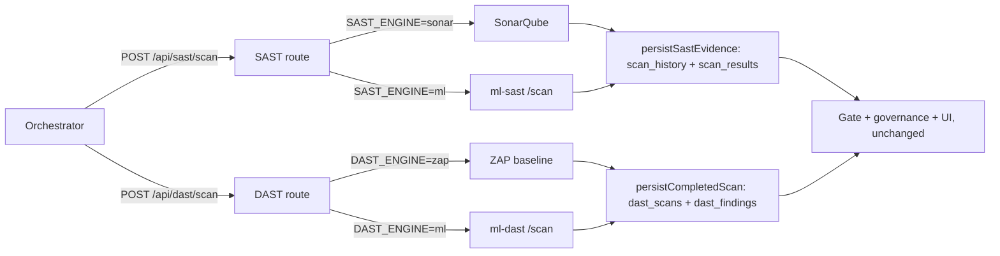

# ML scan engines: architecture

CloudSentinel can run SAST and the baseline DAST stage on trained ML services instead of SonarQube
and ZAP. Targets are Python and Node.js apps only. SonarQube and ZAP remain the default until the ML
engines pass evaluation.

- **ml-sast** has a trained model: `ml-sast-hybrid` 2.0.0 (`models/release_v2/`). It combines a
  function-level Random Forest with a **rule-based** secrets detector for CWE-798. On a fresh set of
  three apps, scored once, it reaches 0.59 macro-F1 against 0.50 for v1 (`ml-sast-rf` 1.0.0), but
  that difference is not statistically significant. Vulnerable precision is about 0.32, so it is not
  yet good enough to replace SonarQube as the gate. Rule-based findings are marked: rule suffix
  `.rule`, and `/model-info` → `components.secrets.type: "rule-based"`. See
  [ml-sast-model-card.md](ml-sast-model-card.md).
- **ml-dast** has a trained model, `ml-dast-lr` 1.0.0 (SQL injection and reflected XSS). It scores 0.87
  endpoint-param macro-F1 in leave-one-app-out over 6 lab app groups, against 0.92 for an offline ZAP
  full scan of the same endpoints. On the frozen DVNA held-out app it found 1 of 2 vulnerable parameters.
  ZAP stays the default. Every request passes a host/port allowlist, same-origin, budget and rate guard;
  set `ML_DAST_ALLOWED_HOSTS` and `ML_DAST_ALLOWED_PORTS` to the staging target. See
  [ml-dast-model-card.md](ml-dast-model-card.md).

## Selection

| Flag | Values | Default | Effect |
|---|---|---|---|
| `SAST_ENGINE` | `sonar`, `ml` | `sonar` | `POST /api/sast/scan/:projectId` uses SonarQube or `ml-sast` |
| `DAST_ENGINE` | `zap`, `ml` | `zap` | `POST /api/dast/scan/:projectId` (baseline path) uses ZAP or `ml-dast` |

Any other value fails the stage with a clear error. Active DAST is unaffected.

## Flow



**SAST (`ml`)**

1. The route creates the `scan_history` row, clones the repository, and calls `runMlSast`.
2. The backend reads `/model-info`. An untrained model is refused (see below).
3. It collects `.py .js .mjs .cjs .jsx .ts .tsx` files. It skips `node_modules`, virtualenvs, build
   output, symlinks, binaries, and files over `ML_SAST_MAX_FILE_BYTES`. Repos over the size limits fail
   instead of being partly scanned.
4. It records `scan_engine='ml'` and `tool_provenance` on the scan row, then posts `{files}` to `/scan`.
5. It validates every finding: the severity scale, that the file is one of the submitted files, the
   line number, the CWE, and the confidence.
6. Each finding becomes a `VULNERABILITY` issue with rule `ml:<rule>:CWE-<n>`. The CWE goes into the
   rule because governance derives SAST references from the rule. The issue is persisted through the
   same transactional `persistSastEvidence` the SonarQube engine uses. The orchestrator gate counts
   `scan_results` exactly as before: CRITICAL and HIGH vulnerabilities block.

**DAST (`ml`)**

1. The backend authorizes the target with the same `authorizeTarget` the ZAP scanner uses: the
   verified staging deployment for pipeline runs, or an owner-configured target for manual runs.
2. It creates a `dast_scans` row with `scan_mode='BASELINE'`.
3. It reads `/model-info`, then posts `{baseUrl, maxPages, maxRequests}` to `/scan`.
4. Findings get the same `fingerprint()` as ZAP findings, are de-duplicated, and are persisted with
   `persistCompletedScan`, which re-verifies the counts and fingerprints.
5. Any failure marks the row `FAILED` with the message in `failure_reason`.

## Provenance

Each ML scan row stores:

- `scan_engine = 'ml'`.
- `tool_provenance`:
  - `tool`: `"<model name> <version> sha256:<SHA-256 of the model file>"`.
  - `model`: name, version, sha256, trainedOn, metrics.
  - Input facts. For SAST: file count, skipped count, and an input digest. For DAST: page and
    request bounds.
- For DAST, `policy_name` and `policy_version` hold the model name and version.

Migration: `backend/migrations/023_scan_engine_provenance.sql`. Without it, ML scans fail with a
message that names the migration. The default engines do not need it.

Provenance-bound STATIC_HTML executions (`PIPELINE_PROVENANCE_ENABLED`) attest Sonar- and ZAP-specific
evidence: a quality gate and a pinned ZAP image. ML engines refuse those executions with
`ML_ENGINE_PROVENANCE_UNSUPPORTED` rather than attesting something weaker.

## Safety rules

- **Untrained models.**
  - Both services answer with an empty findings list and `status: "untrained"`. They never
    invent detections.
  - The backend refuses to complete a scan with an untrained model (`ML_MODEL_UNTRAINED`), because
    an empty result would pass every gate.
  - `ML_ALLOW_UNTRAINED=true` allows it, for plumbing tests only.
- **Unreachable or slow service.**
  - Every call has a timeout: `ML_SAST_TIMEOUT_MS` (default 300 s) and `ML_DAST_TIMEOUT_MS`
    (default 1800 s).
  - On failure the stage fails with the service URL and the cause, for example
    `ML SAST service at http://localhost:8001 is unreachable (ECONNREFUSED)`. The orchestrator
    retries once, as it does for every stage.
- **The ML DAST service scans whatever it is given.** Keep it reachable only from the backend.

## Services

`services-ml/ml-sast` and `services-ml/ml-dast` are FastAPI apps. Each has `GET /health`,
`GET /model-info` and `POST /scan`.

- A model is a joblib artifact mounted at `MODEL_PATH`, with metadata JSON next to it. Its interface
  is described in each service README.
- Model files are never committed; `.gitignore` blocks common model formats.
- Training code belongs in `/ml`.

## Running locally

```bash
cd services-ml/ml-sast && pip install -r requirements.txt && uvicorn app:app --port 8001
cd services-ml/ml-dast && pip install -r requirements.txt && uvicorn app:app --port 8002
psql -d cloudsentinel -f backend/migrations/023_scan_engine_provenance.sql
# backend/.env: SAST_ENGINE=ml DAST_ENGINE=ml ML_SAST_URL=http://localhost:8001 ML_DAST_URL=http://localhost:8002
```

Tests: `cd backend && npm run test:ml`, and `pytest` in each service directory.

### Pipeline with `SAST_ENGINE=ml` on the e2e fixtures

The trained model files are gitignored. Before you start, copy `model.joblib` and `model.json` from a
training run (`services-ml/ml-sast/models/release_v2/`, built by `scripts/package_v2.py`) into that
same folder in your checkout. Alternatively, point `ML_SAST_MODEL_DIR` at the folder that holds them.

```bash
scripts/run-ml-sast.sh                     # ml-sast on 127.0.0.1:8001 with the v2 model; creates the venv on first run
curl -s localhost:8001/model-info          # expect status "trained", ml-sast-hybrid 2.0.0

# Backend with the ML engine. Variables set in the shell override backend/.env.
# PORT also sets the URL the orchestrator uses to call its own stage endpoints.
cd backend && SAST_ENGINE=ml ML_SAST_URL=http://127.0.0.1:8001 PORT=3100 node server.js &
cd .. && E2E_API=http://127.0.0.1:3100 node scripts/e2e-smoke.js python-clean node
```

`e2e-smoke.js` reads its login and the fixture repository URLs from `~/.cloudsentinel-e2e.env`. The
app keys are `python`, `node` and `python-clean`.

Result on 2026-11-20 (ml-sast-hybrid 2.0.0, SHA-256 `00fe69cf…`, Minikube off):

| Fixture | SAST (ML) | Gate |
|---|---|---|
| python-clean | 0 findings | Passed SAST, Dependency (1 low) and IaC. The run then stopped at Deploy because Minikube was off (`kubectl create namespace` failed), so Image and DAST did not run |
| node-express | 3 findings, all true: hardcoded secret, line 7 (**rule-based** detector, `.rule`); SQL injection in `GET /users` (ML); XSS in `GET /search` (ML) | Blocked at SAST (CRITICAL) |

This was a single check. The model was not tuned for these fixtures.
