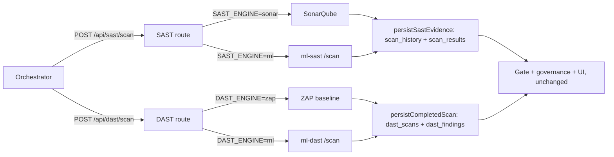

# ML scan engines: architecture

CloudSentinel can run SAST and the baseline DAST stage on trained ML services instead of SonarQube
and ZAP. Targets are Python and Node.js apps only. SonarQube and ZAP remain the default until the ML
engines pass evaluation.

- **ml-sast** has a trained model: `ml-sast-hybrid` 2.0.0 (`models/release_v2/`). It combines a
  function-level Random Forest with a **rule-based** secrets detector for CWE-798. On a fresh set of
  three apps, scored once, it reaches 0.59 macro-F1 against 0.50 for v1 (`ml-sast-rf` 1.0.0), but
  that difference is not statistically significant. Vulnerable precision is about 0.32, so it is not
  yet good enough to replace SonarQube as the gate. Rule-based findings are marked: rule suffix
  `.rule`, and `/model-info` → `components.secrets.type: "rule-based"`. See
  [ml-sast-model-card.md](ml-sast-model-card.md).
- **ml-dast** has a trained model, `ml-dast-lr` 1.0.0 (SQL injection and reflected XSS). It scores 0.87
  endpoint-param macro-F1 in leave-one-app-out over 6 lab app groups, against 0.92 for an offline ZAP
  full scan of the same endpoints. On the frozen DVNA held-out app it found 1 of 2 vulnerable parameters.
  ZAP stays the default. Every request passes a host/port allowlist, same-origin, budget and rate guard;
  set `ML_DAST_ALLOWED_HOSTS` and `ML_DAST_ALLOWED_PORTS` to the staging target. See
  [ml-dast-model-card.md](ml-dast-model-card.md).

## Selection

| Flag | Values | Default | Effect |
|---|---|---|---|
| `SAST_ENGINE` | `sonar`, `ml` | `sonar` | `POST /api/sast/scan/:projectId` uses SonarQube or `ml-sast` |
| `DAST_ENGINE` | `zap`, `ml` | `zap` | `POST /api/dast/scan/:projectId` (baseline path) uses ZAP or `ml-dast` |

Any other value fails the stage with a clear error. Active DAST is unaffected.

## Flow



**SAST (`ml`)**

1. The route creates the `scan_history` row, clones the repository, and calls `runMlSast`.
2. The backend reads `/model-info`. An untrained model is refused (see below).
3. It collects `.py .js .mjs .cjs .jsx .ts .tsx` files. It skips `node_modules`, virtualenvs, build
   output, symlinks, binaries, and files over `ML_SAST_MAX_FILE_BYTES`. Repos over the size limits fail
   instead of being partly scanned.
4. It records `scan_engine='ml'` and `tool_provenance` on the scan row, then posts `{files}` to `/scan`.
5. It validates every finding: the severity scale, that the file is one of the submitted files, the
   line number, the CWE, and the confidence.
6. Each finding becomes a `VULNERABILITY` issue with rule `ml:<rule>:CWE-<n>`. The CWE goes into the
   rule because governance derives SAST references from the rule. The issue is persisted through the
   same transactional `persistSastEvidence` the SonarQube engine uses. The orchestrator gate counts
   `scan_results` exactly as before: CRITICAL and HIGH vulnerabilities block.

**DAST (`ml`)**

1. The backend authorizes the target with the same `authorizeTarget` the ZAP scanner uses: the
   verified staging deployment for pipeline runs, or an owner-configured target for manual runs.
2. It creates a `dast_scans` row with `scan_mode='BASELINE'`.
3. It reads `/model-info`, then posts `{baseUrl, maxPages, maxRequests}` to `/scan`.
4. Findings get the same `fingerprint()` as ZAP findings, are de-duplicated, and are persisted with
   `persistCompletedScan`, which re-verifies the counts and fingerprints.
5. Any failure marks the row `FAILED` with the message in `failure_reason`.

## Provenance

Each ML scan row stores:

- `scan_engine = 'ml'`.
- `tool_provenance`:
  - `tool`: `"<model name> <version> sha256:<SHA-256 of the model file>"`.
  - `model`: name, version, sha256, trainedOn, metrics.
  - Input facts. For SAST: file count, skipped count, and an input digest. For DAST: page and
    request bounds.
- For DAST, `policy_name` and `policy_version` hold the model name and version.

Migration: `backend/migrations/023_scan_engine_provenance.sql`. Without it, ML scans fail with a
message that names the migration. The default engines do not need it.

Provenance-bound STATIC_HTML executions (`PIPELINE_PROVENANCE_ENABLED`) attest Sonar- and ZAP-specific
evidence: a quality gate and a pinned ZAP image. ML engines refuse those executions with
`ML_ENGINE_PROVENANCE_UNSUPPORTED` rather than attesting something weaker.

## Safety rules

- **Untrained models.**
  - Both services answer with an empty findings list and `status: "untrained"`. They never
    invent detections.
  - The backend refuses to complete a scan with an untrained model (`ML_MODEL_UNTRAINED`), because
    an empty result would pass every gate.
  - `ML_ALLOW_UNTRAINED=true` allows it, for plumbing tests only.
- **Unreachable or slow service.**
  - Every call has a timeout: `ML_SAST_TIMEOUT_MS` (default 300 s) and `ML_DAST_TIMEOUT_MS`
    (default 1800 s).
  - On failure the stage fails with the service URL and the cause, for example
    `ML SAST service at http://localhost:8001 is unreachable (ECONNREFUSED)`. The orchestrator
    retries once, as it does for every stage.
- **The ML DAST service scans whatever it is given.** Keep it reachable only from the backend.

## Services

`services-ml/ml-sast` and `services-ml/ml-dast` are FastAPI apps. Each has `GET /health`,
`GET /model-info` and `POST /scan`.

- A model is a joblib artifact mounted at `MODEL_PATH`, with metadata JSON next to it. Its interface
  is described in each service README.
- Model files are never committed; `.gitignore` blocks common model formats.
- Training code belongs in `/ml`.

## Running locally

```bash
cd services-ml/ml-sast && pip install -r requirements.txt && uvicorn app:app --port 8001
cd services-ml/ml-dast && pip install -r requirements.txt && uvicorn app:app --port 8002
psql -d cloudsentinel -f backend/migrations/023_scan_engine_provenance.sql
# backend/.env: SAST_ENGINE=ml DAST_ENGINE=ml ML_SAST_URL=http://localhost:8001 ML_DAST_URL=http://localhost:8002
```

Tests: `cd backend && npm run test:ml`, and `pytest` in each service directory.

### Pipeline with `SAST_ENGINE=ml` on the e2e fixtures

The trained model files are gitignored. Before you start, copy `model.joblib` and `model.json` from a
training run (`services-ml/ml-sast/models/release_v2/`, built by `scripts/package_v2.py`) into that
same folder in your checkout. Alternatively, point `ML_SAST_MODEL_DIR` at the folder that holds them.

```bash
scripts/run-ml-sast.sh                     # ml-sast on 127.0.0.1:8001 with the v2 model; creates the venv on first run
curl -s localhost:8001/model-info          # expect status "trained", ml-sast-hybrid 2.0.0

# Backend with the ML engine. Variables set in the shell override backend/.env.
# PORT also sets the URL the orchestrator uses to call its own stage endpoints.
cd backend && SAST_ENGINE=ml ML_SAST_URL=http://127.0.0.1:8001 PORT=3100 node server.js &
cd .. && E2E_API=http://127.0.0.1:3100 node scripts/e2e-smoke.js python-clean node
```

`e2e-smoke.js` reads its login and the fixture repository URLs from `~/.cloudsentinel-e2e.env`. The
app keys are `python`, `node` and `python-clean`.

Result on 2026-11-20 (ml-sast-hybrid 2.0.0, SHA-256 `00fe69cf…`, Minikube off):

| Fixture | SAST (ML) | Gate |
|---|---|---|
| python-clean | 0 findings | Passed SAST, Dependency (1 low) and IaC. The run then stopped at Deploy because Minikube was off (`kubectl create namespace` failed), so Image and DAST did not run |
| node-express | 3 findings, all true: hardcoded secret, line 7 (**rule-based** detector, `.rule`); SQL injection in `GET /users` (ML); XSS in `GET /search` (ML) | Blocked at SAST (CRITICAL) |

This was a single check. The model was not tuned for these fixtures.

## Running the full ML pipeline

This runs both ML engines (`SAST_ENGINE=ml`, `DAST_ENGINE=ml`) through deploy to Minikube and DAST
against the staging app. Start Minikube first (`minikube start`). If the ml-dast lab is running, stop
it to free RAM (`cd services-ml/ml-dast/lab && docker compose down`).

**Model files.** These are gitignored, so copy them in from a training run:

| Service | Folder | Built by |
|---|---|---|
| ml-sast | `services-ml/ml-sast/models/release_v2/model.{joblib,json}` | `services-ml/ml-sast/scripts/package_v2.py` |
| ml-dast | `services-ml/ml-dast/models/release/model.{joblib,json}` | `services-ml/ml-dast/scripts/train_final.py` |

**Target allowlist.** ml-dast refuses every target outside its allowlist with HTTP 400, before
sending any traffic. The pipeline's DAST target is the authorized staging URL,
`http://<minikube ip>:<NodePort>`. Kubernetes assigns that NodePort when it deploys, so no fixed port
can be allowed in advance. `scripts/run-ml-dast.sh` (default `--minikube`) therefore sets:

- `ML_DAST_ALLOWED_HOSTS` to exactly `minikube ip`;
- `ML_DAST_ALLOWED_PORTS` to the cluster's NodePort range, read from kube-apiserver
  `--service-node-port-range` (default 30000-32767).

Nothing else is allowed, not even localhost, the API server port or other hosts. The backend still
authorizes the exact staging URL first. Set the two variables by hand to narrow them further.

**Reachability: host process.** Docker runs natively in WSL here, so the Minikube bridge
(192.168.49.0/24) is a local interface. A host process reaches `http://<minikube ip>:<NodePort>`
directly. A containerized ml-dast would need `--network minikube` instead.

```bash
scripts/run-ml-sast.sh &                   # 127.0.0.1:8001, ml-sast-hybrid 2.0.0
scripts/run-ml-dast.sh --minikube &        # 127.0.0.1:8002, ml-dast-lr 1.0.0, allow <minikube ip>:30000-32767
cd backend && PORT=3100 SAST_ENGINE=ml DAST_ENGINE=ml \
  ML_SAST_URL=http://127.0.0.1:8001 ML_DAST_URL=http://127.0.0.1:8002 node server.js &
cd .. && E2E_API=http://127.0.0.1:3100 node scripts/e2e-smoke.js node python-clean
```

Optional env:

| Variable | Default | Meaning |
|---|---|---|
| `ML_DAST_MAX_PAGES` | 50 | Per-scan page budget the backend passes |
| `ML_DAST_MAX_REQUESTS` | 500 | Per-scan request budget the backend passes |
| `ML_DAST_SEED_PATHS` | unset | Comma-separated extra crawl start paths on the staging target, e.g. `/users?name=alice,/search?q=test` (see [DAST demo](#dast-demo)) |
| `ML_DAST_OPENAPI_URL` | unset | Path (or same-origin URL) of an OpenAPI/Swagger JSON document on the staging target, e.g. `/openapi.json` |
| `ML_SAST_VENV`, `ML_DAST_VENV` | – | Reuse existing venvs |
| `DAST_ACTIVE_ENABLED` | unset | Leave unset: Active DAST is the frozen ZAP active scanner and is not part of this run |

### e2e results (2026-11-20)

Engines: ml-sast-hybrid 2.0.0 (`00fe69cf…`) and ml-dast-lr 1.0.0 (`ce04524f…`); both SHA-256 values
were recorded as scan provenance. Minikube was at 192.168.49.2.

| Stage | node-express (vulnerable) | python-clean |
|---|---|---|
| SAST (ML) | 3 s: C1 H2. All 3 true: hardcoded secret (**rule-based**), SQLi `GET /users`, XSS `GET /search` | 2 s: 0 findings |
| Dependency | not run | 20 s: L1 (3 packages) |
| IaC | not run | 11 s: 0 |
| Image | not run | 22 s: H48 M110 L67. Not a blocking stage: the orchestrator gates only SAST, Dependency and IaC |
| Deploy | not run | success, `http://192.168.49.2:32707` |
| DAST (ML) | not run | 0.1 s, 0 findings. **Nothing to test**: 1 page crawled, 0 injection points, 1 request |
| **Gate** | **Blocked at SAST** (CRITICAL), 3 s | **Passed**, pipeline COMPLETED in 372 s |

**What works:**
- Both ML engines run inside the real pipeline.
- The clean app passes, and the vulnerable fixture is blocked at SAST with only true findings.
- The ml-dast allowlist accepts the staging NodePort and nothing else.

**What doesn't:**
- **The DAST stage is vacuous on these fixtures.** Both apps answer `/` with JSON and contain no links
  or forms, so the ml-dast crawler finds no injection points.
- I also ran the same detector, outside the pipeline, against the older node-express staging
  deployment (NodePort 31344): 1 page, 0 points, 0 findings. Its `/users?name` SQLi and `/search?q` XSS
  are unreachable without seed URLs or an API description.
- This is the crawler limitation documented in the ml-dast model card. Neither model was tuned for
  these fixtures.

## DAST demo

The goal: show the ML DAST stage finding real issues on a staging app. Two pieces make that possible:

- **Crawl seeds.** ml-dast `/scan` accepts `seedPaths` and `openapiUrl` (see
  `services-ml/ml-dast/README.md`). The backend sends them from `ML_DAST_SEED_PATHS` and
  `ML_DAST_OPENAPI_URL`. Projects have no per-project scan settings field, so seeds apply per
  backend instance.
  - Both the backend and ml-dast resolve every seed against the authorized staging URL. A seed on
    any other origin is refused before any traffic.
  - The seeds and ml-dast's crawl coverage (`pages`, `points_found`, `points_probed`, `requests`)
    are stored in `dast_scans.tool_provenance`.
- **Demo target** `demo/forms-app/`, mirrored at the public repo
  https://github.com/hammad0-dev/cloudsentinel-demo-forms. It is a Flask catalogue whose endpoints
  are all linked from HTML:

  | Endpoint | Input | Ground truth |
  |---|---|---|
  | `GET /search` | `q` | SQL injection (CWE-89) |
  | `GET /search-safe` | `q` | safe |
  | `POST /feedback` | `name` | reflected XSS (CWE-79) |
  | `POST /feedback` | `message` | safe (not echoed) |
  | `POST /feedback-safe` | `name`, `message` | safe |

  It ships a non-root Dockerfile and hardened `k8s/` manifests. `k8s/.appname` names the
  Deployment for the deploy stage.

**Commands.** These assume the services from [Running the full ML pipeline](#running-the-full-ml-pipeline).

```bash
# 1. Pipeline run (fixture "demo-forms"; repo URL defaults to the public mirror, override with E2E_DEMO_FORMS_REPO)
E2E_API=http://127.0.0.1:3100 node scripts/e2e-smoke.js demo-forms

# 2. DAST on the same app outside the pipeline (used here because SAST blocks the pipeline first)
cd demo/forms-app && docker build -t demo-forms:0.1.0 . && minikube image load demo-forms:0.1.0
kubectl create namespace cs-dast-demo && kubectl -n cs-dast-demo create serviceaccount cloudsentinel-app
kubectl -n cs-dast-demo apply -f k8s/ && kubectl -n cs-dast-demo rollout status deployment/demo-forms
URL=http://$(minikube ip):$(kubectl -n cs-dast-demo get svc demo-forms -o jsonpath='{.spec.ports[0].nodePort}')
#    then set it as the project's DAST target and scan through the backend (owner-configured target):
#    PATCH /api/dast/target/<projectId> {"target_url": "$URL"};  POST /api/dast/scan/<projectId>
# 3. Seeds for an app the crawler cannot see (JSON root), directly against ml-dast:
curl -s -X POST 127.0.0.1:8002/scan -H 'content-type: application/json' \
  -d '{"baseUrl":"http://192.168.49.2:31344","seedPaths":["/users?name=alice","/search?q=test"]}'
# cleanup: kubectl delete namespace cs-dast-demo
```

**Expected output.**
- Step 1 ends with `Gate: BLOCKED — CRITICAL security vulnerability found in SAST stage`, followed
  by the SAST rows.
- Step 2 returns `{"success":true,…,"summary":{"total":3,"high":3,…},"coverage":{"pages":7,"points_found":6,…}}`.

### Demo results (2026-11-20)

Engines: ml-sast-hybrid 2.0.0 and ml-dast-lr 1.0.0 (`ce04524f…`), threshold 0.9. No seeds were set
for the demo app. Nothing was tuned to it; the app was written before it was scanned and was not
changed afterwards.

**Pipeline** (project 27, execution 79): **blocked at SAST** in 3 s. It was not deployed, so the
pipeline's DAST stage did not run. That is the gate working as designed: a CRITICAL SAST finding
stops the pipeline before deploy.

| SAST (ML) finding | Line (function) | Verdict |
|---|---|---|
| CRITICAL SQL injection | 92 `search` | **true** |
| HIGH XSS | 110 `feedback` | **true** |
| HIGH XSS | 69 `page` (layout renders `body \| safe`) | true sink, shared by every page; debatable |
| CRITICAL SQL injection | 50 `init_db` (constant DDL, parameterized `executemany`) | false alarm |
| CRITICAL SQL injection | 101 `search_safe` (parameterized) | false alarm |
| HIGH XSS | 73 `product_table` (autoescaped template) | false alarm |
| HIGH XSS | 84 `index` (static HTML) | false alarm |
| HIGH XSS | 119 `feedback_safe` (autoescaped template) | false alarm |

ML SAST reports per function. It found both real bugs but also flagged both safe twins and three
other functions: 5 of 8 findings are false alarms.

**ML DAST outside the pipeline.** Same image and manifests, deployed to namespace `cs-dast-demo` at
`http://192.168.49.2:31989`. The scan ran through the backend runner (`dast_scans` 31,
`owner_configured_target`) with the pipeline budgets (50 pages, 500 requests). It took **14.9 s**:
7 pages, 6 injection points, 289 requests.

| Endpoint, parameter | Ground truth | ML DAST | Result |
|---|---|---|---|
| `GET /search` `q` | SQLi | HIGH CWE-89, payload `test') OR 1=2-- -`, evidence "status 500 (baseline 200)" | **true finding** |
| `POST /feedback` `name` | XSS | HIGH CWE-79, `'><svg onload=…>` reflected unencoded | **true finding** |
| `POST /feedback-safe` `name` | safe | HIGH CWE-79, payload `javascript:cs…()` "reflected unencoded" in text context | **false alarm** |
| `GET /search-safe` `q` | safe | none | true negative |
| `POST /feedback` `message`, `POST /feedback-safe` `message` | safe | none | true negatives |

The scan found both real vulnerabilities, missed nothing, and raised 1 false alarm in 3 findings.
The false alarm is a payload with no HTML special characters: escaping leaves it unchanged, so it
looks "reflected unencoded" even though it is harmless in a text context.

**Seeds on a real staging app.** This was a direct ml-dast call against the node-express staging
app (NodePort 31344), whose `/` returns JSON:

| Seeds | Coverage | Findings |
|---|---|---|
| none | 1 page, 0 points, 1 request | none (nothing tested) |
| `/users?name=alice`, `/search?q=test` | 3 pages, 2 points, 97 requests, 4.8 s | CWE-89 `GET /users` `name` (0.9995), CWE-79 `GET /search` `q` (0.9993), both true and matching that app's SAST findings |
| `http://example.com/x` | none | HTTP 400 `target refused: host 'example.com' is not in the allowlist`, no traffic |
